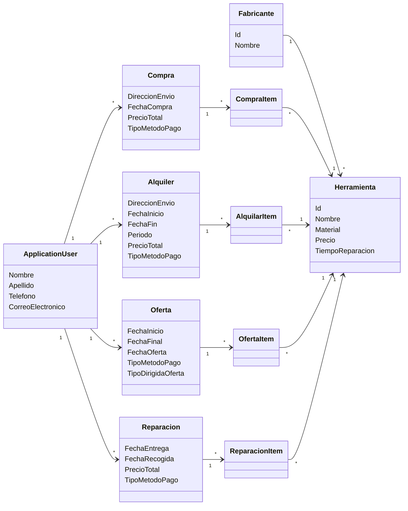

# 🛠️ Tool Store Management

A full-stack .NET application for managing a tool store. Customers can **buy**, **rent** and **send tools for repair**, and the store can publish **discount offers** on its catalogue.

> 🎓 **Academic team project.** Built by a team of four students for **Software Engineering II** (*Ingeniería del Software II*), 3rd year of the **Bachelor's Degree in Computer Engineering** (*Grado en Ingeniería Informática*) at the **University of Castilla-La Mancha (UCLM)**, academic year 2025/2026.
>
> 📦 Original repository: <https://github.com/ISII-2526-GrupoA-TheHookahMasters/ISII2526TheHookahMasterss>
>
> This repository is a copy of the original, kept for portfolio purposes. The full commit history is preserved on the `development` branch.

---

## 📋 Table of Contents

- [Overview](#-overview)
- [Features](#-features)
- [Tech Stack](#-tech-stack)
- [Architecture](#-architecture)
- [Domain Model](#-domain-model)
- [Project Structure](#-project-structure)
- [Getting Started](#-getting-started)
- [API Documentation](#-api-documentation)
- [Development Methodology](#-development-methodology)
- [Team](#-team)
- [License](#-license)

---

## 🔎 Overview

The system models a tool shop with a catalogue of tools, each linked to a manufacturer. Registered users go through four business processes (use cases), and each one follows the same flow:

1. **Select** tools from the catalogue (with filters).
2. **Create** the operation: fill in the details, choose a payment method and confirm.
3. **View the details** of the operation they just created.

Each use case was designed and implemented end-to-end, from the REST API to the Blazor UI, along with its tests.

---

## ✨ Features

| Use case | Description |
|---|---|
| 🛒 **Purchase** (*Compra*) | Buy one or more tools, with quantities, a shipping address and a payment method. |
| 📅 **Rental** (*Alquiler*) | Rent tools for a date range. The rental period and total price are calculated from the start and end dates. |
| 🏷️ **Offers** (*Oferta*) | Create time-limited discount offers on a set of tools (a percentage per tool), aimed at members or customers. |
| 🔧 **Repair** (*Reparación*) | Send tools for repair, with drop-off and pick-up dates, a description of the problem and a price per item. |
| 🏭 **Catalogue** | Tools (name, material, price, repair time) and their manufacturers. |
| 🔐 **Authentication** | User registration, login and account management with ASP.NET Core Identity (including 2FA support). |

Available payment methods: **credit card**, **PayPal** and **cash**.

---

## 🧰 Tech Stack

**Backend**
- C# / .NET 8
- ASP.NET Core Web API
- Entity Framework Core 8 (code-first, migrations)
- SQL Server (LocalDB) · SQLite (in-memory, for testing) · Azure SQL
- ASP.NET Core Identity (with roles)
- Swagger / OpenAPI (Swashbuckle) · NSwag (client generation)

**Frontend**
- Blazor Web App (Razor components)
- .NET MAUI Blazor Hybrid (cross-platform client: Android, iOS, macOS, Windows)
- Bootstrap

**Tooling and process**
- Unit and integration tests (`test/` project)
- GitHub Actions (CI)
- GitHub Projects (Scrum board, sprints, issues)
- Git flow with feature branches and pull requests

---

## 🏗️ Architecture

```
┌──────────────────────┐      ┌──────────────────────┐
│  AppForSEII2526.Web  │      │ AppForSEII2526.Maui  │
│   (Blazor Web App)   │      │ (Blazor Hybrid app)  │
└──────────┬───────────┘      └──────────┬───────────┘
           │   HTTP / REST (NSwag-generated client)
           └──────────────┬──────────────┘
                          ▼
              ┌──────────────────────┐
              │  AppForSEII2526.API  │
              │ ASP.NET Core Web API │
              │  Controllers · DTOs  │
              └──────────┬───────────┘
                         │ EF Core
                         ▼
              ┌──────────────────────┐
              │ SQL Server / SQLite  │
              └──────────────────────┘
```

- **API**: REST controllers per use case (`CompraController`, `AlquilarController`, `OfertaController`, `ReparacionController`, `HerramientaController`, `FabricanteController`). DTOs separate the API contract from the domain entities.
- **Web**: Blazor pages per use case (`Select…` → `Create…` → `Detail…`). State containers keep the user's selection across pages.
- **The database provider** is chosen at runtime through the `DBConnection2Use` environment variable (`SQLite`, `AzureSQL`, or LocalDB by default).

---

## 🗂️ Domain Model



Each operation is linked to its tools through an item entity with a composite key (`OperationId`, `HerramientaId`). The item stores data specific to that line: quantity, price, discount percentage or repair description.

> Domain entities are named in Spanish, as required by the course.

---

## 📁 Project Structure

```
├── .github/workflows/        # CI pipelines
├── req/                      # Requirements and design documents
├── src/
│   ├── AppForSEII2526.API/   # REST API
│   │   ├── Controllers/
│   │   ├── Data/             # DbContext and seed data
│   │   ├── DTOs/             # Data transfer objects per use case
│   │   ├── Migrations/
│   │   └── Models/           # Domain entities
│   ├── AppForSEII2526.Web/   # Blazor web frontend
│   │   └── Components/Pages/ # Alquiler, Compra, Oferta, Reparacion
│   └── AppForSEII2526.Maui/  # .NET MAUI Blazor Hybrid client
├── test/                     # Automated tests
└── AppForSEII2526.sln
```

---

## 🚀 Getting Started

### Prerequisites

- [.NET 8 SDK](https://dotnet.microsoft.com/download/dotnet/8.0)
- Visual Studio 2022 (workloads: *ASP.NET and web development*; add *.NET MAUI* for the mobile client)
- SQL Server LocalDB (installed with Visual Studio), or use SQLite

### Run locally

```bash
git clone https://github.com/ivangomezr/tool-store-management.git
cd tool-store-management
git checkout development
```

1. Open `AppForSEII2526.sln` in Visual Studio.
2. Check the `DefaultConnection` connection string in `src/AppForSEII2526.API/appsettings.json`.
3. Set **multiple startup projects**: `AppForSEII2526.API` + `AppForSEII2526.Web`.
4. Press **F5**. Migrations are applied automatically on startup.

To use an in-memory SQLite database instead of LocalDB:

```powershell
$env:DBConnection2Use = "SQLite"
dotnet run --project src/AppForSEII2526.API
```

### Run the tests

```bash
dotnet test
```

---

## 📖 API Documentation

In the `Development` environment, Swagger UI is available at:

```
https://localhost:<port>/swagger
```

The OpenAPI specification is also stored in `src/AppForSEII2526.API/OpenAPIs/swagger.json`.

---

## 🔄 Development Methodology

The project followed **Scrum** across several sprints:

- Product backlog and sprint planning on **GitHub Projects**.
- One **issue per task**, each worked on its own branch (`<issue-number>-<description>`) and merged into `development` through **pull requests** with code review.
- Each team member owned one use case end-to-end (API, UI and tests), plus the shared catalogue and authentication.
- Team activity was monitored by the course's **Bluejay** governance platform (commit, issue and PR metrics).

---

## 👥 Team

Developed by team **TheHookahMasters** (Group A):

| Member | GitHub |
|---|---|
| Iván Gómez | [@ivangomezr](https://github.com/ivangomezr) |
| Alejandro Navarrete | [@AlejandroNvarrete](https://github.com/AlejandroNvarrete) |
| Sergio Requena | [@SergioReque](https://github.com/SergioReque) |
| José Enrique Ortiz | [@kikolonx](https://github.com/kikolonx) |

Project template provided by the Software Engineering II teaching staff at **ESIIAB – UCLM** ([SEII-SSDD-IPO-template](https://github.com/Ingenieria-del-Software-II-ESIIAB/SEII-SSDD-IPO-template)).

---

## 📄 License

This project is licensed under the **GNU General Public License v3.0**. See [LICENSE](LICENSE) for details.
