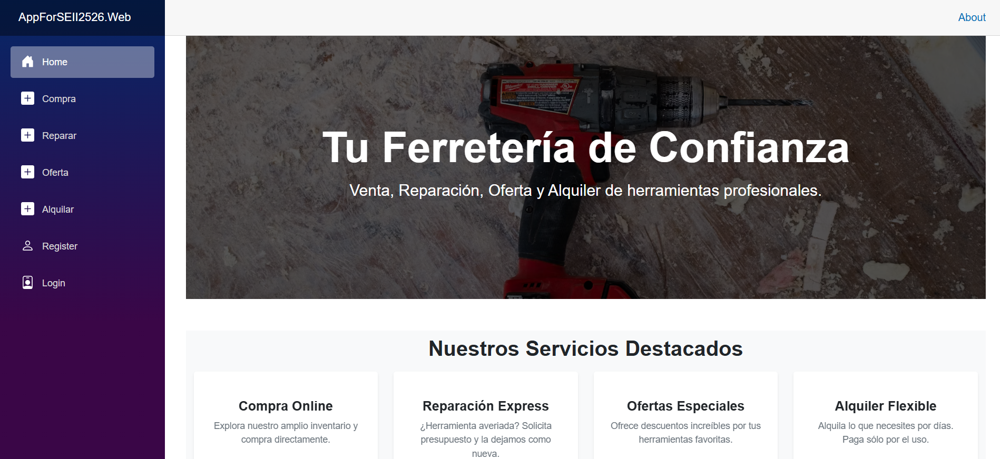
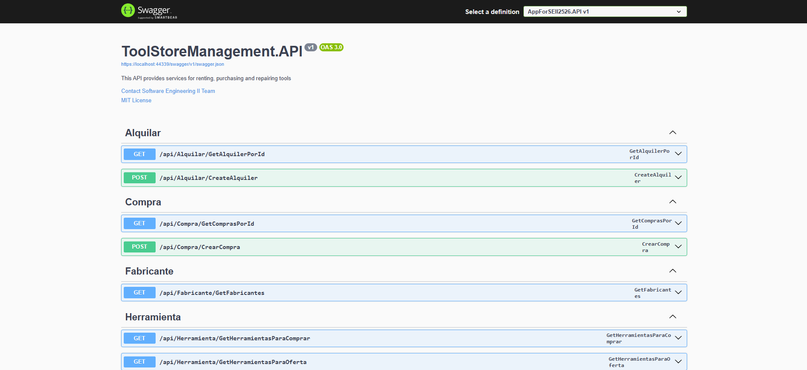
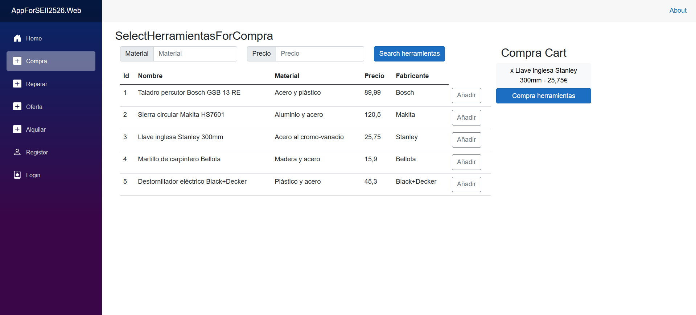
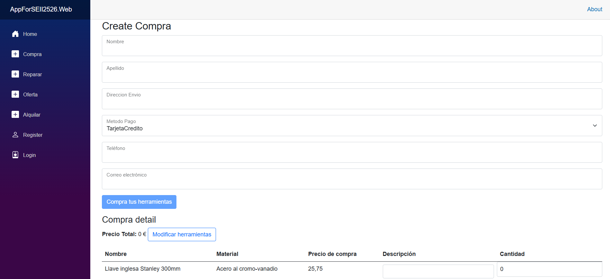
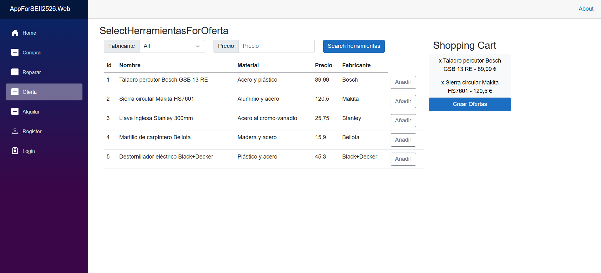
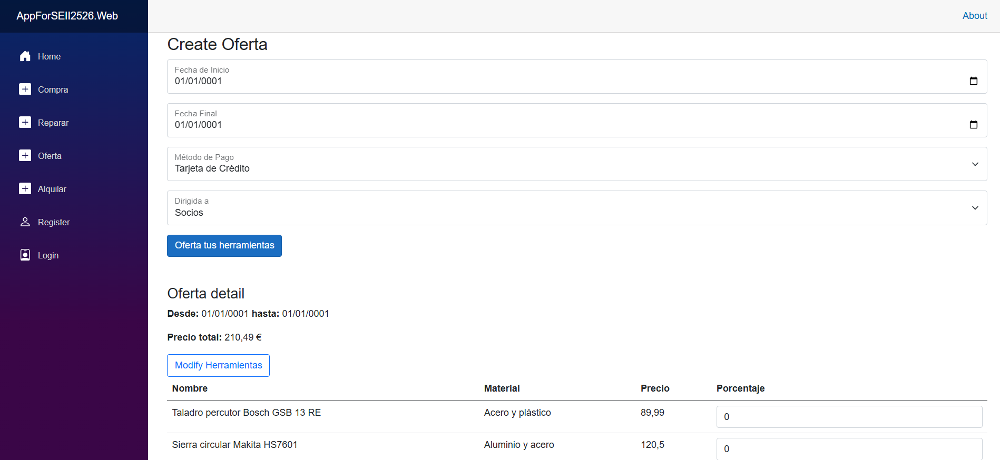

# Tool Store Management


A full-stack .NET application for managing a tool store. Customers can **buy**, **rent** and **send tools for repair**, and the store can publish **discount offers** on its catalogue.

The system models a tool shop with a catalogue of tools, each linked to a manufacturer. The application is organized around four main business processes (use cases), and each one follows the same flow:

Tool Store Management is designed to manage the main processes of a tool shop. Users can browse the tool catalogue and create different types of operations. The application is divided into a REST API, a Blazor web client and a .NET MAUI Blazor Hybrid client.

The project was developed as a team assignment, following the software engineering practices covered in the course: requirements analysis, domain modelling, iterative development, version control, automated testing and collaborative work.

> **Academic project** — Developed for *Software Engineering II (Ingeniería del Software II)*, third year of the Bachelor's Degree in Computer Engineering at the **University of Castilla-La Mancha (UCLM)**, School of Computer Engineering (Albacete, Spain), during the 2025–2026 academic year.

---

## 📸 Screenshots

| Main page | API documentation |
|---|---|
|  |  |

| Purchases | Create Purchase |
|---|---|
|  |  |

| Offers | Create offers |
|---|---|
|  |  |

## Main features

| Area | Description |
|---|---|
| 🛒 **Purchase** (*Compra*) | Buy one or more tools, with quantities, a shipping address and a payment method. |
| 📅 **Rental** (*Alquiler*) | Rent tools for a date range. The rental period and total price are calculated from the start and end dates. |
| 🏷️ **Offers** (*Oferta*) | Create time-limited discount offers on a set of tools (a percentage per tool), aimed at members or customers. |
| 🔧 **Repair** (*Reparación*) | Send tools for repair, with drop-off and pick-up dates, a description of the problem and a price per item. |
| 🏭 **Catalogue** | Tools (name, material, price, repair time) and their manufacturers. |
| 🔐 **Authentication (incomplete)** | Login and registration pages are present in the Web project, but the authentication workflow is not fully implemented or operational. See [Authentication status](#authentication-status). |

Available payment methods: **credit card**, **PayPal** and **cash**.

### Authentication status

Authentication is an **incomplete feature** in the current state of the project.

- The login page is available, but a complete, working login flow has not been implemented.
- The registration page previously produced an error when opened. This issue was partially fixed, and the page can now be displayed.
- The registration service itself is still not operational. Email delivery and account confirmation are not implemented as a working service, so users cannot complete the intended registration and confirmation process.

Therefore, the Login and Register pages should be considered unfinished interfaces, not functional authentication features. The project should not be used with the expectation that users can register and log in successfully.

---

## Technology stack

**Backend**
- C# and .NET 8
- ASP.NET Core Web API
- Entity Framework Core 8
- SQL Server / LocalDB
- SQLite (in-memory database option)
- ASP.NET Core Identity
- Swagger / OpenAPI

**Frontend**
- Blazor Web App
- .NET MAUI Blazor Hybrid
- Razor components
- Bootstrap

**Tooling and process**
- Unit and integration tests (`test/` project)
- GitHub Actions (CI)
- GitHub Projects (Scrum board, sprints, issues)
- Git flow with feature branches and pull requests

---

## 🏗️ Architecture

```text
┌──────────────────────┐      ┌──────────────────────┐
│  AppForSEII2526.Web  │      │ AppForSEII2526.Maui  │
│   (Blazor Web App)   │      │ (Blazor Hybrid app)  │
└──────────┬───────────┘      └──────────┬───────────┘
           │   HTTP / REST (NSwag-generated client)
           └──────────────┬──────────────┘
                          ▼
              ┌──────────────────────┐
              │  AppForSEII2526.API  │
              │ ASP.NET Core Web API │
              │  Controllers · DTOs  │
              └──────────┬───────────┘
                         │ EF Core
                         ▼
              ┌──────────────────────┐
              │ SQL Server / SQLite  │
              └──────────────────────┘
```

The API is organised around the main business areas, with controllers for purchases, rentals, offers, repairs, tools and manufacturers. Data Transfer Objects (DTOs) define the data exchanged between the clients and the API.

The database provider can be selected through the `DBConnection2Use` environment variable:
- `SQLite`: in-memory SQLite database.
- `AzureSQL`: Azure SQL using the `AzureSQL` environment variable as the connection string.
- Any other value or an unset variable: SQL Server LocalDB using the configured `DefaultConnection`.

## Project structure

> Domain entities are named in Spanish, as required by the course.

---

## 📁 Project Structure

```text
├── .github/workflows/        # CI pipelines
├── req/                      # Requirements and design documents
├── src/
│   ├── AppForSEII2526.API/         # ASP.NET Core REST API
│   │   ├── Controllers/
│   │   ├── Data/
│   │   ├── DTOs/
│   │   ├── Migrations/
│   │   └── Models/
│   ├── AppForSEII2526.Web/         # Blazor web application
│   │   └── Components/
│   └── AppForSEII2526.Maui/       # .NET MAUI Blazor Hybrid application
├── test/
│   ├── AppForSEII2526.UT/          # Unit tests
│   └── AppForSEII2526.UIT/         # UI tests
└── AppForSEII2526.sln
```

## Getting started

### Prerequisites

- .NET 8 SDK
- Visual Studio 2022 with the **ASP.NET and web development** workload
- SQL Server LocalDB (usually installed with Visual Studio), or configure the API to use SQLite
- .NET MAUI workload if you want to run the MAUI client

### Clone the repository

```bash
git clone https://github.com/ivangomezr/tool-store-management.git
cd tool-store-management
git checkout development
```

### Configure and run

1. Open `AppForSEII2526.sln` in Visual Studio.
2. Check the `DefaultConnection` connection strings in the API and Web project configuration files.
3. Configure the API base URL in `src/AppForSEII2526.Web/appsettings.json`, under `AppForHerramientas_API`, so that it matches the URL and port used by the API launch profile.
4. Set `AppForSEII2526.API` and `AppForSEII2526.Web` as startup projects.
5. Start the solution.

The API applies Entity Framework Core migrations at startup when using SQL Server. When using the SQLite option, the API creates the in-memory database on startup.

> **Note:** The API and Web projects must use matching connection settings and the Web project's API URL must point to the actual address where the API is listening. These values can differ between Visual Studio launch profiles and machines.

## Database configuration

The default configuration uses SQL Server LocalDB. To select the in-memory SQLite provider when starting the API from PowerShell:

```powershell
$env:DBConnection2Use = "SQLite"
dotnet run --project src/AppForSEII2526.API/AppForSEII2526.API.csproj
```

For Azure SQL, set `DBConnection2Use` to `AzureSQL` and provide the connection string through the `AzureSQL` environment variable.

Do not commit personal credentials or production connection strings to the repository.

## Running the tests

Run the solution's automated tests from the repository root:

```bash
dotnet test
```

The solution contains separate unit-test and UI-test projects under `test/`.

## Authentication status

The Web application includes ASP.NET Core Identity pages for login and registration.

```text
https://localhost:<port>/swagger
```

Authentication is therefore a known incomplete area of the current project.

---

## 🔄 Development Methodology

Suggested screenshots:

1. **Main page / dashboard** — the first screen users see when opening the application.
2. **Tool catalogue** — the list of tools, including filters and relevant product information.
3. **Purchase workflow** — tool selection and the purchase details/confirmation screen.
4. **Rental workflow** — rental selection and the date-range form.
5. **Repair workflow** — repair request form, including the problem description.
6. **Offers** — offer creation or offer listing, showing discount and validity dates.
7. **API Swagger UI** — the API endpoints grouped by controller.
8. **Login and registration pages** — useful to show the implemented interface, but make sure the README's authentication limitation remains clear.

Example Markdown to add once the screenshots are available:

```md

```

Prefer screenshots at a consistent viewport size. Crop out personal information, credentials, tokens, connection strings and any real customer data. A good set of four to six representative images is usually enough; the catalogue, main page, one complete workflow and Swagger are the best starting points.

## Development workflow

The project was developed collaboratively using an iterative workflow based on Scrum practices. Work was organised through issues, a project board, feature branches and pull requests. GitHub Actions was used for continuous integration.

## Team

Developed by **TheHookahMasters (Group A)** for Software Engineering II at UCLM:

| Member | GitHub |
|---|---|
| Iván Gómez | [@ivangomezr](https://github.com/ivangomezr) |
| Alejandro Navarrete | [@AlejandroNvarrete](https://github.com/AlejandroNvarrete) |
| Sergio Requena | [@SergioReque](https://github.com/SergioReque) |
| José Enrique Ortiz | [@kikolonx](https://github.com/kikolonx) |

---

*This repository is an academic project and is not intended to be presented as a production-ready commercial application.*
