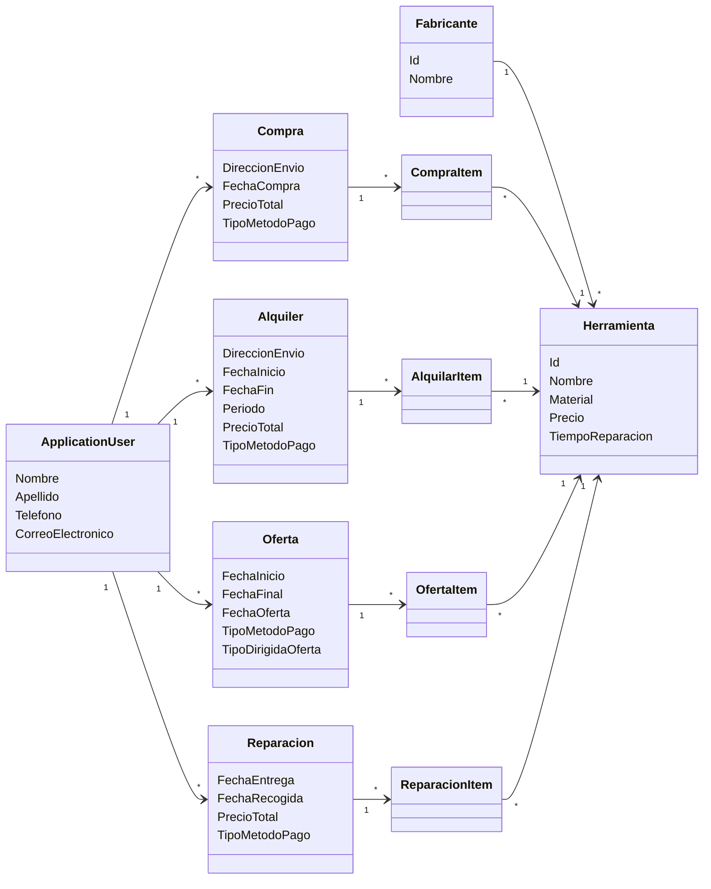

# 🛠️ Tool Store Management


A full-stack .NET application for managing a tool store. Customers can **buy**, **rent** and **send tools for repair**, and the store can publish **discount offers** on its catalogue.

> 🎓 **Academic team project.** Built by a team of four students for **Software Engineering II** (*Ingeniería del Software II*), 3rd year of the **Bachelor's Degree in Computer Engineering** (*Grado en Ingeniería Informática*) at the **University of Castilla-La Mancha (UCLM)**, academic year 2025/2026.
>
> 📦 Original repository: <https://github.com/ISII-2526-GrupoA-TheHookahMasters/ISII2526TheHookahMasterss>
>
> This repository is a copy of the original, kept for portfolio purposes. The full commit history is preserved on the `development` branch.

---

## 📸 Screenshots

| Main page | API documentation |
|---|---|
|  |  |

| Purchases | Create Purchase |
|---|---|
|  |  |

| Offers | Create offers |
|---|---|
|  |  |

---

## 🔎 Overview

The system models a tool shop with a catalogue of tools, each linked to a manufacturer. The application is organized around four main business processes (use cases), and each one follows the same flow:

1. **Select** tools from the catalogue (with filters).
2. **Create** the operation: fill in the details, choose a payment method and confirm.
3. **View the details** of the operation they just created.

Each use case was designed and implemented end-to-end, from the REST API to the Blazor UI, along with its tests.

---

## ✨ Features

| Use case | Description |
|---|---|
| 🛒 **Purchase** (*Compra*) | Buy one or more tools, with quantities, a shipping address and a payment method. |
| 📅 **Rental** (*Alquiler*) | Rent tools for a date range. The rental period and total price are calculated from the start and end dates. |
| 🏷️ **Offers** (*Oferta*) | Create time-limited discount offers on a set of tools (a percentage per tool), aimed at members or customers. |
| 🔧 **Repair** (*Reparación*) | Send tools for repair, with drop-off and pick-up dates, a description of the problem and a price per item. |
| 🏭 **Catalogue** | Tools (name, material, price, repair time) and their manufacturers. |
| 🔐 **Authentication (incomplete)** | Login and registration pages are present in the Web project, but the authentication workflow is not fully implemented or operational. See [Authentication status](#authentication-status). |

Available payment methods: **credit card**, **PayPal** and **cash**.

### Authentication status

Authentication is an **incomplete feature** in the current state of the project.

- The login page is available, but a complete, working login flow has not been implemented.
- The registration page previously produced an error when opened. This issue was partially fixed, and the page can now be displayed.
- The registration service itself is still not operational. Email delivery and account confirmation are not implemented as a working service, so users cannot complete the intended registration and confirmation process.

Therefore, the Login and Register pages should be considered unfinished interfaces, not functional authentication features. The project should not be used with the expectation that users can register and log in successfully.

---

## 🧰 Tech Stack

**Backend**
- C# / .NET 8
- ASP.NET Core Web API
- Entity Framework Core 8 (code-first, migrations)
- SQL Server (LocalDB) · SQLite (in-memory, for testing) · Azure SQL
- ASP.NET Core Identity (with roles)
- Swagger / OpenAPI (Swashbuckle) · NSwag (client generation)

**Frontend**
- Blazor Web App (Razor components)
- .NET MAUI Blazor Hybrid (cross-platform client: Android, iOS, macOS, Windows)
- Bootstrap

**Tooling and process**
- Unit and integration tests (`test/` project)
- GitHub Actions (CI)
- GitHub Projects (Scrum board, sprints, issues)
- Git flow with feature branches and pull requests

---

## 🏗️ Architecture

```text
┌──────────────────────┐      ┌──────────────────────┐
│  AppForSEII2526.Web  │      │ AppForSEII2526.Maui  │
│   (Blazor Web App)   │      │ (Blazor Hybrid app)  │
└──────────┬───────────┘      └──────────┬───────────┘
           │   HTTP / REST (NSwag-generated client)
           └──────────────┬──────────────┘
                          ▼
              ┌──────────────────────┐
              │  AppForSEII2526.API  │
              │ ASP.NET Core Web API │
              │  Controllers · DTOs  │
              └──────────┬───────────┘
                         │ EF Core
                         ▼
              ┌──────────────────────┐
              │ SQL Server / SQLite  │
              └──────────────────────┘
```

- **API**: REST controllers per use case (`CompraController`, `AlquilarController`, `OfertaController`, `ReparacionController`, `HerramientaController`, `FabricanteController`). DTOs separate the API contract from the domain entities.
- **Web**: Blazor pages per use case (`Select…` → `Create…` → `Detail…`). State containers keep the user's selection across pages.
- **The database provider** is chosen at runtime through the `DBConnection2Use` environment variable (`SQLite`, `AzureSQL`, or LocalDB by default).

---

## 🗂️ Domain Model



Each operation is linked to its tools through an item entity with a composite key (`OperationId`, `HerramientaId`). The item stores data specific to that line: quantity, price, discount percentage or repair description.

> Domain entities are named in Spanish, as required by the course.

---

## 📁 Project Structure

```text
├── .github/workflows/        # CI pipelines
├── req/                      # Requirements and design documents
├── src/
│   ├── AppForSEII2526.API/   # REST API
│   │   ├── Controllers/
│   │   ├── Data/             # DbContext and seed data
│   │   ├── DTOs/             # Data transfer objects per use case
│   │   ├── Migrations/
│   │   └── Models/           # Domain entities
│   ├── AppForSEII2526.Web/   # Blazor web frontend
│   │   └── Components/Pages/ # Alquiler, Compra, Oferta, Reparacion
│   └── AppForSEII2526.Maui/  # .NET MAUI Blazor Hybrid client
├── test/                     # Automated tests
└── AppForSEII2526.sln
```

---

## 🚀 Getting Started

### Prerequisites

- [.NET 8 SDK](https://dotnet.microsoft.com/download/dotnet/8.0)
- Visual Studio 2022 (workloads: *ASP.NET and web development*; add *.NET MAUI* for the mobile client)
- SQL Server LocalDB (installed with Visual Studio), or use SQLite

### Run locally

```bash
git clone https://github.com/ivangomezr/tool-store-management.git
cd tool-store-management
git checkout development
```

1. Open `AppForSEII2526.sln` in Visual Studio.
2. Check the `DefaultConnection` connection string in `src/AppForSEII2526.API/appsettings.json`.
3. Set **multiple startup projects**: `AppForSEII2526.API` + `AppForSEII2526.Web`.
4. Press **F5**. Migrations are applied automatically on startup.

To use an in-memory SQLite database instead of LocalDB:

```powershell
$env:DBConnection2Use = "SQLite"
dotnet run --project src/AppForSEII2526.API
```

### Run the tests

```bash
dotnet test
```

---

## 📖 API Documentation

In the `Development` environment, Swagger UI is available at:

```text
https://localhost:<port>/swagger
```

The OpenAPI specification is also stored in `src/AppForSEII2526.API/OpenAPIs/swagger.json`.

---

## 📸 Screenshots

Screenshots are stored in the `screenshots/` directory and displayed in the same side-by-side table layout used in the [opel-cars-jpa](https://github.com/ivangomezr/opel-cars-jpa) repository.

| Main page | Tool catalogue |
|---|---|
|  |  |

| Purchase workflow | Rental workflow |
|---|---|
|  |  |

| Repair request | Promotional offers |
|---|---|
|  |  |

| API documentation | Login and registration interface |
|---|---|
|  |  |

Add the corresponding `.png` files to the `screenshots/` directory using these exact filenames. The login and registration screenshot documents the available interface only; it does not imply that authentication is functional.

Use screenshots captured from the running project at a consistent viewport size. Hide personal information, credentials, tokens, connection strings and real customer data.

---

## 🔄 Development Methodology

The project followed **Scrum** across several sprints:

- Product backlog and sprint planning on **GitHub Projects**.
- One **issue per task**, each worked on its own branch (`<issue-number>-<description>`) and merged into `development` through **pull requests** with code review.
- Each team member owned one use case end-to-end (API, UI and tests), plus the shared catalogue and authentication.
- Team activity was monitored by the course's **Bluejay** governance platform (commit, issue and PR metrics).

---

## 👥 Team

Developed by team **TheHookahMasters** (Group A):

| Member | GitHub |
|---|---|
| Iván Gómez | [@ivangomezr](https://github.com/ivangomezr) |
| Alejandro Navarrete | [@AlejandroNvarrete](https://github.com/AlejandroNvarrete) |
| Sergio Requena | [@SergioReque](https://github.com/SergioReque) |
| José Enrique Ortiz | [@kikolonx](https://github.com/kikolonx) |

Project template provided by the Software Engineering II teaching staff at **ESIIAB – UCLM** ([SEII-SSDD-IPO-template](https://github.com/Ingenieria-del-Software-II-ESIIAB/SEII-SSDD-IPO-template)).

---

## 📄 License

This project is licensed under the **GNU General Public License v3.0**. See [LICENSE](LICENSE) for details.
